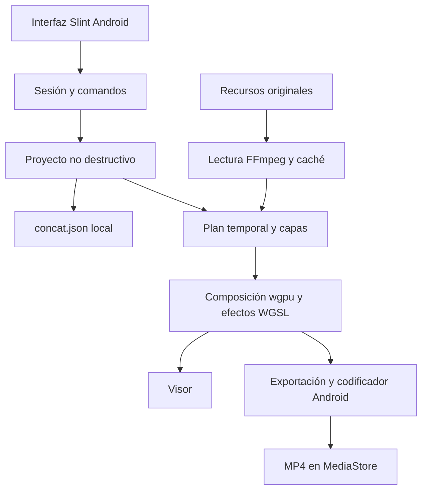

# Arquitectura de EditPop sobre Concat

La aplicación actual usa la base completa de Concat, Rust y Slint, con FFmpeg,
wgpu y puentes Java/JNI para Android. La decisión evita reimplementar su motor
en Kotlin y mantener dos compositores. No es una web ni una envoltura de CapCut.
La app Kotlin anterior se conserva aparte y sus proyectos no se migran todavía.

## Responsabilidades reales

| Capa | Código | Responsabilidad |
|---|---|---|
| Interfaz móvil | src/crates/concat/ui/phone, concat-ui | Pantallas y controles Slint, compilados para Android |
| Coordinación | concat/src/studio.rs y studio/ | Selección, propiedades, tareas y publicación de estado en UI |
| Sesión | concat-host/src/session.rs | Un Editor del motor es dueño del proyecto; la ventana no mantiene otro modelo |
| Operaciones | concat-project | Command, historial de deshacer/rehacer, colocación, recortes y modelo documental |
| Persistencia | concat-host/src/projects.rs, concat-project/src/doc.rs | concat.json, guardado temporal y rename, carga y migraciones |
| Tiempo | concat-core | Racionales, tasas de fotogramas, retiming y representación de fotogramas |
| Recursos | concat-media, concat-android/java | Lectura FFmpeg, selección SAF, copias de importación y publicación MediaStore |
| Previsualización | concat-host/src/preview.rs y playback.rs | Lectores reutilizados, proxies cuando proceden y preparación de capas |
| Composición | concat-render | FramePlan, capas, transformaciones, transiciones y compositor wgpu |
| Efectos | concat-effects | Catálogo con parámetros y programas WGSL; incluye editpop.grain-reduction |
| Exportación | concat-export, concat-host/src/export.rs | Calendario de fotogramas, composición, codificación y progreso |
| Texto | concat-text | Preparación de títulos para composición; recorrido móvil ampliado aún pendiente |
| Automatización | concat-api, concat-server | API opcional; las pruebas activan solo loopback con token efímero |

## Contrato temporal y de composición

El documento guarda decisiones de edición y referencias a recursos; no sobrescribe
los originales. concat.json usa versión1 y conserva un espejo de la línea activa
para lectores anteriores. La carga distingue migración, lectura y normalización.
Una versión futura incompatible se rechaza; algunas entradas inválidas del
upstream se descartan al normalizar. Por ello, recuperación de documentos dañados
y conservación de todos sus elementos siguen necesitando pruebas específicas.

El documento usa segundos f64; el núcleo temporal y la planificación usan
racionales y tasas de fotogramas. Posición del clip, intervalo de fuente y
velocidad tienen responsabilidades diferentes. El detector propio de escenas
cuantiza las propuestas a la cuadrícula del proyecto y agrupa los cortes en una
única operación de historial. No hay que confundir esa cuadrícula con la tasa
variable de una fuente: la selección y sincronización de VFR real requieren
verificación sobre los recursos completos y el dispositivo.

Visor y exportación usan el mismo modelo y las reglas del compositor. El tamaño
del visor puede ser menor y puede usar proxies; un efecto espacial aplicado a
otra resolución puede variar. Las comparaciones de precisión se hacen a igual
tamaño. El archivo final no debe heredar automáticamente la resolución del proxy.

## Ampliaciones propias

- Importación exclusiva y sincronizada por bloques, limpieza de copias fallidas.
- Publicación MediaStore que comprueba bytes y confirmación antes de retirar el temporal.
- Adaptación móvil, identidad, español y color inicial de EditPop.
- Correcciones de arranque/configuración MediaCodec y etiquetas de color.
- Sugerencias locales de cambios de escena, selección, descarte y aplicación deshacible.
- Filtro espacial de grano mediante paquete propio, parámetros editables y sin modelos.

## Límites que permanecen abiertos

La base contiene muchas funciones, pero cada recorrido debe comprobarse en móvil.
La matriz SEGUIMIENTO-CONCAT.csv distingue implementación de verificación.
Las dependencias de IA del upstream siguen incluidas; su aislamiento para la
primera entrega permanece pendiente. No se han descargado modelos ni enviado
vídeos personales a pruebas remotas.

La capa Android revisada no acredita todavía un servicio de exportación en
primer plano con notificación y protección completa del ciclo de vida. Bloquear
pantalla, interrupciones, muerte de proceso y segundo plano requieren integración
y pruebas. Una exportación interrumpida no tiene reanudación verificada y puede
necesitar reiniciarse. No se promete que el trabajo sobreviva a esos casos.

Las mediciones del compilador remoto se documentan separadas del rendimiento
del teléfono. El SamsungS26 físico, memoria, temperatura, búsqueda y reproducción
sostenida siguen pendientes. AGPL-3.0-or-later y los avisos de Concat se conservan;
la distribución incluye fuente correspondiente y licencias de dependencias.
